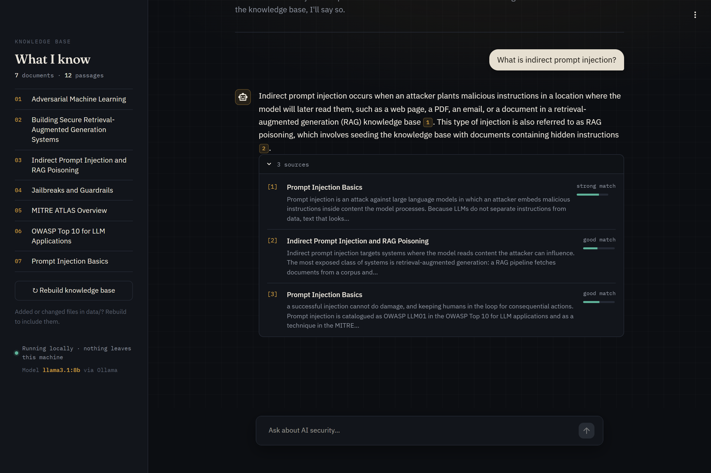
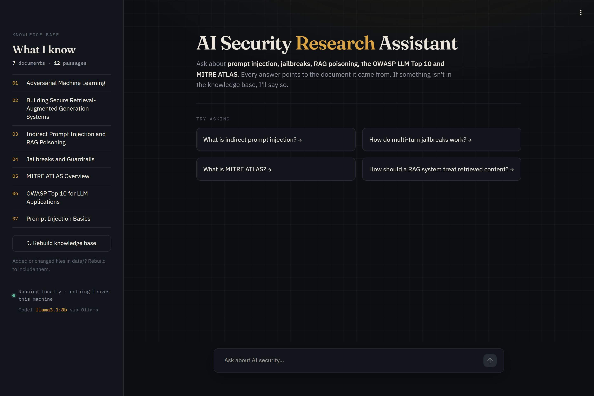
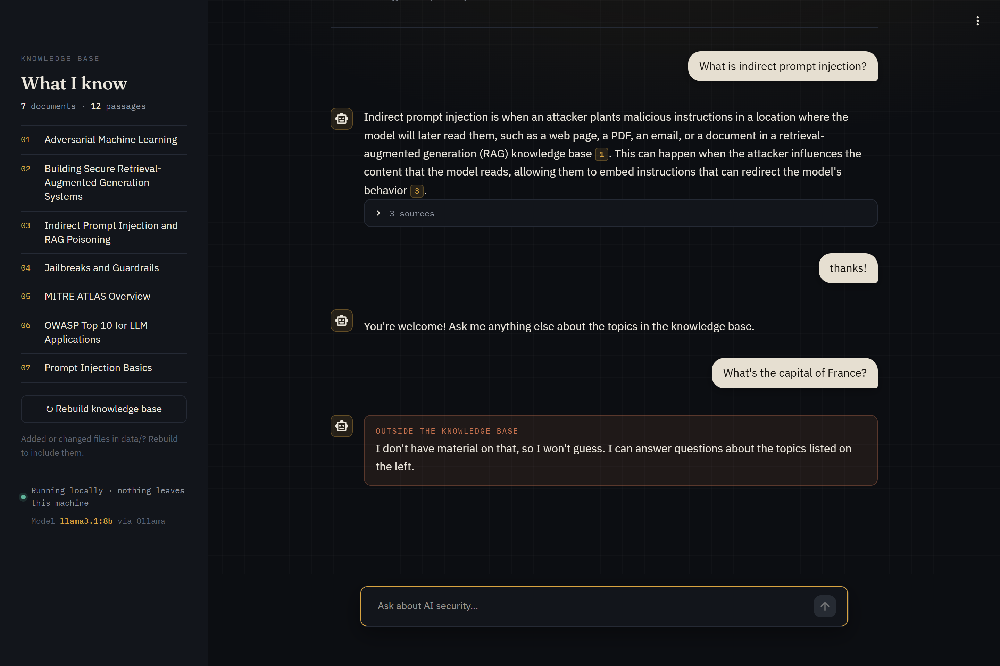
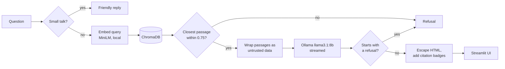
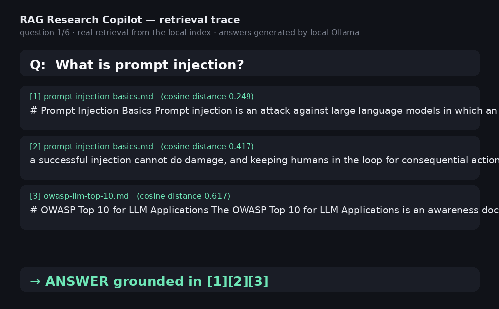

# AI Security Research Assistant

A local, private RAG assistant that answers questions about AI security **with citations, or an honest "I don't know"**. Embeddings, vector search and the LLM all run on your own machine. No API keys, and no data leaves your machine.



## Built to be trusted

Most RAG demos stop at "it answers". This one focuses on the three behaviours that matter when the answers need to be trusted:

- **Citations on every answer.** Each claim carries a `[n]` badge that maps to the exact passage it came from, with a match-strength bar so you can judge the evidence.
- **Refusal instead of hallucination.** If nothing in the knowledge base is close enough, it says so without calling the LLM. If the model starts to refuse and then keeps going from memory, the extra text is cut before it reaches the screen.
- **Treats documents as hostile.** Retrieved passages are wrapped as untrusted data, documents can't forge the wrapper, and everything the model outputs is HTML-escaped before display. A poisoned document can't inject scripts or exfiltrate data through markdown images.

| Empty state | Small talk + refusal |
|---|---|
|  |  |

## Measured, not guessed

Every tuning decision below came from a measurement on this project, not a default.

| Decision | What was measured | Result |
|---|---|---|
| Refusal cutoff = **0.75** cosine distance | All 25 eval questions scored 0.25–0.69; off-topic messages ("thanks", "capital of France", "pizza recipe") scored 0.84–0.96 | The old cutoff (1.1) never triggered, so off-topic chat got answered from random passages. 0.75 sits in the gap. |
| Keep **llama3.1:8b**, reject llama3.2:3b | Same questions on both | The 3B model answered ~2× faster but said "I don't have relevant material" and then **answered from memory anyway**. Speed isn't worth breaking the core guarantee. |
| **3 passages** per question instead of 5 | Timed end to end | 40–97s → 12–20s per answer, same answers and citations |
| Run on the **integrated GPU** | Ollama logs showed it detected the integrated GPU and then skipped it by default | Generation 9 → 18 tokens/s; answers 8–12s |
| **Stream** answers + **warm up** models at launch | Time to first words; first question after launch | First words in ~3–5s. First question after launch 14s+ → 5.4s |

Current numbers: **96% retrieval hit-rate** (24/25), **47 unit tests**, answers start appearing within a few seconds on integrated graphics (no discrete GPU needed).

## Security model

Untrusted content goes through three independent layers:

1. **Prompt layer.** Passages are wrapped in `<untrusted>` tags and the system prompt forbids following instructions inside them. Any `<untrusted`/`</untrusted>` text inside a document is neutralised, so a poisoned document can't close the wrapper early and pose as trusted instructions. *(Unit-tested.)*
2. **Output layer.** Model answers, document excerpts and titles are HTML-escaped **first**. Only then are fixed elements added (citation badges, bold, lists). Raw HTML, ``, links and markdown images never render, which closes the classic exfiltration-via-image-URL trick. *(Unit-tested.)*
3. **Refusal layer.** Low-relevance questions never reach the LLM, and refuse-then-hallucinate output is truncated. *(Unit-tested.)*

**Live red-team** ([`evals/injection_eval.py`](evals/injection_eval.py)): 8 attacks (instruction override, delimiter escape, fake authority, image exfiltration, system-prompt leak, three kinds of fact/link poisoning) × 3 runs against the real model:

| | Model resisted | Safe after rendering |
|---|---|---|
| Defended pipeline | 24/24 | 24/24 |
| Control: naive prompt, no defenses (`--control`) | 24/24 | 24/24 |

**Read this honestly:** the control resisted too. llama3.1:8b's own safety training ignores these attacks, so this run **can't show** that the prompt-layer defenses add anything on top. That's why layers 1–3 are verified with deterministic unit tests instead of relying on the model. A stronger attack set (for example, a poisoned passage ranked first) is on the roadmap.

## How it works



| Layer | Choice | Runs |
|---|---|---|
| Embeddings | sentence-transformers `all-MiniLM-L6-v2` (384-dim) | local CPU |
| Vector DB | ChromaDB, persistent | local disk |
| LLM | Ollama `llama3.1:8b` (swappable via `.env`) | local GPU/CPU |
| UI | Streamlit, custom theme, self-hosted fonts | local |
| Tests | pytest + retrieval eval, GitHub Actions | CI |

## Quickstart

You need Python 3.11+ and [Ollama](https://ollama.com).

**Windows (PowerShell)**
```powershell
python -m venv .venv
.\.venv\Scripts\Activate.ps1
pip install -r requirements.txt
ollama pull llama3.1:8b
python evals/run_eval.py --reingest   # builds the index from data/ and prints the eval report
streamlit run app.py
```

**Mac / Linux**
```bash
python3 -m venv .venv
source .venv/bin/activate
pip install -r requirements.txt
ollama pull llama3.1:8b
python evals/run_eval.py --reingest
streamlit run app.py
```

To use your own documents, drop `.md`, `.txt` or `.pdf` files into `data/` and click **Rebuild knowledge base** in the sidebar. Settings (model, cutoff, passages per answer) live in `.env`; copy `.env.example` to start.

**Speed tips:**
- **Intel/AMD laptop with integrated graphics:** set `OLLAMA_IGPU_ENABLE=1`, otherwise Ollama ignores the iGPU.
- **Avoid reload pauses:** set `OLLAMA_KEEP_ALIVE=30m` so the model stays loaded between questions.
- **Apply them:** restart Ollama after setting either one.

## Docker (one command, still fully local)

```bash
docker compose up --build
docker compose exec ollama ollama pull llama3.1:8b   # first run only
# open http://localhost:8501
```

The app runs in one container, Ollama in another; your corpus (`./data`), the
vector index, and the query log (`./cache`) are volume-mounted, so rebuilds
keep everything. No API keys, nothing leaves the machine except the model pull.

## Observability

Every turn appends one JSONL record to `cache/query_log.jsonl` (gitignored —
stays on your machine): the query, retrieved sources with cosine distances,
refusal/small-talk flags, and latency split into retrieval vs. total. Logged
best-effort — a broken log file can never break a chat turn.

```python
from observability import stats, summarize_line
summarize_line()   # e.g. "12 turns · refusal rate 8% · retrieval median 14.2ms · total median 2.4s"
stats()            # totals, refusal rate, median latencies, hit distribution by source
```

These are the three numbers worth quoting in an interview: refusal rate
(how often the system admits it doesn't know), retrieval latency, and which
sources actually get retrieved.

## Demo



Regenerate it (runs real retrieval against your index, no LLM needed):
`python scripts/make_demo_gif.py --still`

## Tests and evals

```bash
pytest -q                                  # 56 unit tests: chunking, cache, refusal, streaming, escaping, injection guards, observability
python evals/run_eval.py                   # retrieval hit-rate, fails below 80% (CI gate)
python evals/injection_eval.py             # live red-team (needs Ollama)
python evals/injection_eval.py --control   # same attacks against a naive undefended prompt
```

CI ([`.github/workflows/ci.yml`](.github/workflows/ci.yml)) runs the unit tests and the retrieval eval on every push. The red-team needs a running LLM, so it runs locally; its latest reports are committed in [`evals/`](evals/).

To regenerate the screenshots: `pip install playwright`, then `python scripts/take_screenshots.py`. This drives the real app in headless Edge.

## Project layout

```
app.py                  # Streamlit entry point: wires UI + RAG together
rag.py                  # small talk -> retrieve -> refusal gate -> streamed, cited answer
config.py               # settings from .env + lazy client singletons
observability.py        # per-turn JSONL query log + stats (refusal rate, latency)
warmup.py               # loads the embedding model + LLM in the background at launch
ingest/                 # loader (txt/md/pdf) -> chunker -> embedder (+ SQLite cache) -> ChromaDB
ui/                     # render.py (escape-first HTML), sidebar.py, knowledge_base.py, styles.css
evals/                  # retrieval eval + prompt-injection red-team, with reports
tests/                  # unit tests
scripts/                # demo-GIF generator (real retrieval), screenshot generator
data/sample-corpus/     # AI-security sample documents
```

## Known limitations and roadmap

- **No conversation memory:** each question is answered on its own, so follow-ups like "tell me more" don't work yet.
- **Red-team can't separate prompt defenses from model training.** Next step: stronger attacks, poisoned passages ranked first, and smaller or less safety-tuned models as targets.
- [ ] Conversation memory (rewrite follow-ups into standalone questions)
- [ ] Hybrid search (BM25 + vectors) and re-ranking
- [x] Docker setup (`docker compose up --build`) — deployment stays local on purpose: the privacy story ("documents never leave your machine") *is* the differentiator

## License

[MIT](LICENSE). Bundled fonts (Fraunces, IBM Plex) are under the SIL Open Font License; see `static/fonts/`.
